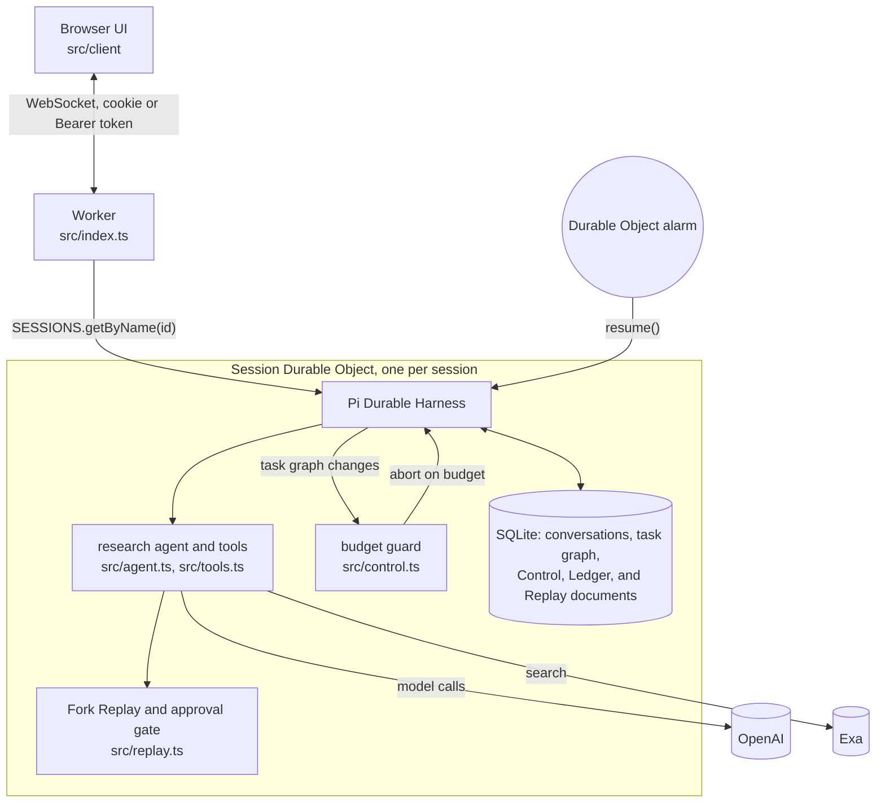

# pi-durable-replay

A control plane for durable agent runs on Cloudflare. You can replay a failed run without firing its tools again, and you can kill a runaway loop before it spends your budget.

The app runs [`@earendil-works/pi-durable`](https://www.npmjs.com/package/@earendil-works/pi-durable) inside one Durable Object per session. It is forked from [`earendil-works/pi-durable-cloudflare`](https://github.com/earendil-works/pi-durable-cloudflare). [SPEC.md](SPEC.md) defines the product, [GLOSSARY.md](GLOSSARY.md) defines its terms, and [docs/adr](docs/adr) records the decisions. Pi Durable is experimental, so its APIs may change.

This is a single-user tool, not a production service.

## Core features

| Feature             | What it does                                                                                                                                                                                   | Code                                                                                                        |
| ------------------- | ---------------------------------------------------------------------------------------------------------------------------------------------------------------------------------------------- | ----------------------------------------------------------------------------------------------------------- |
| Research agent      | Splits a question across three parallel subagent conversations, searches the web through Exa, and answers with citations.                                                                      | `src/agent.ts`, `src/tools.ts`                                                                              |
| Chat                | Renders each conversation in the style of assistant-ui's Generative UI example: markdown answers, collapsible tool rows, and a card per tool in its own terms.                                 | `src/client/Thread.tsx`, `src/client/useSessionRuntime.ts`, `src/client/projection.ts`, `src/client/tools/` |
| Live task graph     | The **Activity** panel shows each run, its tool calls, and the subagents they started.                                                                                                         | `src/client/ActivityPanel.tsx`                                                                              |
| Kill at four scopes | Stops one tool call, one run, one conversation, or every conversation. Stopping a task also stops the work it started, from the bottom up.                                                     | `src/session.ts`, `src/control.ts`                                                                          |
| Budget kill         | Stops a run that crosses its token or turn budget, 100,000 tokens or 30 turns by default. The **Control** panel names the budget that fired. A budget edit applies from the next run.          | `src/control.ts`                                                                                            |
| Fork Replay         | Starts a new conversation from an earlier message. Completed tool results carry over, so safe tools do not run again. `charge_credits` stays blocked until you approve it on the blocked call. | `src/replay.ts`, `src/client/tools/ToolCard.tsx`                                                            |
| Exactly-once charge | `charge_credits` writes one Ledger entry per conversation, amount, and memo. A retried charge returns the existing entry.                                                                      | `src/tools.ts`                                                                                              |
| Crash recovery      | After an eviction or a crash, the Durable Object alarm wakes the session and the run resumes from its last checkpoint. A tool that crashes 5 times in a row ends with `restart_limit`.         | `src/session.ts`, `src/faults.ts`                                                                           |
| Fault injection     | The **Control** panel can interrupt a live charge, start a crash loop, or evict the Durable Object.                                                                                            | `src/faults.ts`                                                                                             |
| One-token sign-in   | You enter `CONTROL_TOKEN` once. The browser keeps an `HttpOnly` cookie that every tab and WebSocket sends. Scripts send `Authorization: Bearer`.                                               | `src/index.ts`                                                                                              |

## How it works

The Worker checks the token and forwards each session to its own Durable Object. That object holds every conversation, task, and document of the session in its SQLite store, so a crash or an eviction loses nothing that was committed.



1. The browser opens a WebSocket to `/api/sessions/:id`, and the Worker forwards it to the session's Durable Object.
2. A message starts a run. Each tool call and each subagent is a durable task with its own committed checkpoint.
3. The budget guard watches the task graph and aborts the run when its usage crosses a budget.
4. If the object is evicted or crashes, the alarm calls `resume()`. Safe tools rerun, and an interrupted `charge_credits` is reported as interrupted instead of running again.

[SPEC.md](SPEC.md#how-the-system-works) has more diagrams for sign-in, kill scopes, the exactly-once charge, Fork Replay, and recovery.

## Run it locally

You need Bun 1.4 or newer and an OpenAI API key.

```sh
bun install
cp .dev.vars.example .dev.vars
```

Set your keys in `.dev.vars`. Without an Exa key, set `SEARCH_BACKEND=corpus` so search uses the built-in corpus.

```dotenv
OPENAI_API_KEY=your-key
SEARCH_BACKEND=corpus
```

Start the Worker and the React client, then open the URL that Vite prints:

```sh
bun run dev
```

To see recovery outside Cloudflare, run the `kill -9` demo. It kills the agent during a tool call, then resumes it in a new process. `slow_search` reruns, and `charge_credits` is reported interrupted with one Ledger entry.

```sh
OPENAI_API_KEY=... bun run demo:local-kill
```

## Commands

```sh
bun run dev     # Worker and client in development
bun run test    # Vitest suite, run through Bun
bun run check   # formatting, types, build, and deploy dry run
bun run build   # production build
bun run preview # serve the production build locally
```

Tests always search the built-in corpus, so they run offline.

## Deploy

A push to `main` runs `.github/workflows/deploy.yml`. The workflow runs the check and the tests, then deploys with `wrangler deploy`.

Before the first deploy, add these repository secrets in **Settings > Secrets and variables > Actions**:

- `CLOUDFLARE_API_TOKEN`, a token with the **Edit Cloudflare Workers** policy
- `CLOUDFLARE_ACCOUNT_ID`
- `OPENAI_API_KEY`
- `CONTROL_TOKEN`, the password for this app
- `EXA_API_KEY`

The workflow uploads the last three as Worker secrets in the same step as the deploy. Always set `CONTROL_TOKEN` in a deployment, because without it the API is open. Rotating `CONTROL_TOKEN` signs every browser out.

## Further reading

- [Pi Durable announcement](https://earendil.com/posts/pi-durable/)
- [pi-durable package documentation](https://github.com/earendil-works/pi/tree/main/packages/durable)
- [Cloudflare Durable Objects](https://developers.cloudflare.com/durable-objects/)
