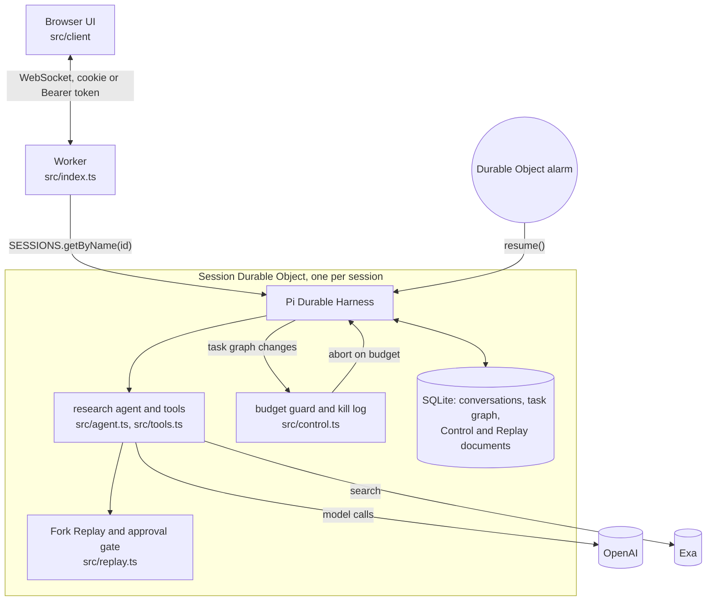

# pi-durable-replay

A control plane for durable agent runs on Cloudflare. You can replay a failed run without firing its tools again, and you can kill a runaway loop before it spends your budget.

The app runs [`@earendil-works/pi-durable`](https://www.npmjs.com/package/@earendil-works/pi-durable) inside one Durable Object per session. It is forked from [`earendil-works/pi-durable-cloudflare`](https://github.com/earendil-works/pi-durable-cloudflare). [SPEC.md](SPEC.md) defines the product, [GLOSSARY.md](GLOSSARY.md) defines its terms, and [docs/adr](docs/adr) records the decisions. Pi Durable is experimental, so its APIs may change.

This is a single-user tool, not a production service.

## Core features

The demo shows three pi-durable features, plus one fault that proves recovery.

| Feature           | What it does                                                                                                                                                                                      | Code                                                                                                        |
| ----------------- | ------------------------------------------------------------------------------------------------------------------------------------------------------------------------------------------------- | ----------------------------------------------------------------------------------------------------------- |
| Cost control      | Each run has a token budget and a turn budget, 100,000 tokens or 30 turns by default. The Budget Kill stops a run that crosses either one. A budget edit applies from the next run.               | `src/control.ts`                                                                                            |
| Kill switch       | The composer's **Kill run** button stops the live run and everything it owns, from the bottom up. The **Control** panel's kill log records every kill and its reason, manual or budget.           | `src/control.ts`, `src/session.ts`                                                                          |
| Fork Replay       | Starts a new conversation from an earlier message. Completed tool results carry over, so `search` and `research` do not run again. `loop_forever` stays blocked until you press **Approve loop**. | `src/replay.ts`, `src/client/tools/ToolCard.tsx`                                                            |
| Crash now         | The **Control** panel's **Crash now** button evicts the Durable Object. The alarm wakes the session, and the run resumes from its last checkpoint.                                                | `src/session.ts`                                                                                            |
| Research agent    | Splits a question across three parallel subagent conversations, searches the web through Exa, and answers with citations.                                                                         | `src/agent.ts`, `src/tools.ts`                                                                              |
| Chat              | Renders each conversation in the style of assistant-ui's Generative UI example: markdown answers, collapsible tool rows, and a card per tool in its own terms.                                    | `src/client/Thread.tsx`, `src/client/useSessionRuntime.ts`, `src/client/projection.ts`, `src/client/tools/` |
| Live task graph   | The **Activity** panel shows each run, its tool calls, and the subagents they started. It is read-only.                                                                                           | `src/client/ActivityPanel.tsx`                                                                              |
| One-token sign-in | You enter `CONTROL_TOKEN` once. The browser keeps an `HttpOnly` cookie that every tab and WebSocket sends. Scripts send `Authorization: Bearer`.                                                  | `src/index.ts`                                                                                              |

The agent has three tools. `search` and `research` are safe, so they may run again after a crash. `loop_forever` is unsafe. It recruits subagents until a kill or a budget stops it, so the kill switch and the Budget Kill have real work to stop.

## How it works

The Worker checks the token and forwards each session to its own Durable Object. That object holds every conversation, task, and document of the session in its SQLite store, so a crash or an eviction loses nothing that was committed.



1. The browser opens a WebSocket to `/api/sessions/:id`, and the Worker forwards it to the session's Durable Object.
2. A message starts a run. Each tool call and each subagent is a durable task with its own committed checkpoint.
3. The budget guard watches the task graph and kills the run when its usage crosses a budget. **Kill run** sends the same kill by hand. Both kills land in the kill log.
4. Fork Replay forks a conversation at an earlier entry and carries its completed tool results forward. If the source conversation called `loop_forever`, the fork blocks `loop_forever` until you approve it.
5. If the object is evicted, the alarm calls `resume()`. Safe tools rerun, and an interrupted `loop_forever` is reported as interrupted instead of running again.

[SPEC.md](SPEC.md#how-the-system-works) has more diagrams for sign-in, the run kill, Fork Replay, and recovery.

## Try the demo

1. Ask the agent to research a question. Press **Crash now** while the subagents run. The run resumes and answers.
2. Ask the agent to search and then call `loop_forever`. Press **Kill run**. The kill log shows `run · manual`.
3. Choose **Fork Replay** on the agent's message, then send "Go on." in the new conversation. The carried `search` result does not run again. When the model calls `loop_forever`, the call is blocked and shows **Approve loop**.
4. Press **Approve loop**, then send "Go on." again. The loop runs until the Budget Kill stops it. The kill log shows `run · budget · turns`.

## Run it locally

You need Bun 1.4 or newer and an OpenAI API key.

```sh
bun install
cp .dev.vars.example .dev.vars
```

Set your keys in `.dev.vars`. Without an Exa key, set `SEARCH_BACKEND=corpus` so search uses the built-in corpus.

```dotenv
OPENAI_API_KEY=your-key
SEARCH_BACKEND=corpus
```

Start the Worker and the React client, then open the URL that Vite prints:

```sh
bun run dev
```

## Commands

```sh
bun run dev     # Worker and client in development
bun run test    # Vitest suite, run through Bun
bun run check   # formatting, types, build, and deploy dry run
bun run build   # production build
bun run preview # serve the production build locally
```

Tests always search the built-in corpus, so they run offline.

## Deploy

A push to `main` runs `.github/workflows/deploy.yml`. The workflow runs the check and the tests, then deploys with `wrangler deploy`.

Before the first deploy, add these repository secrets in **Settings > Secrets and variables > Actions**:

- `CLOUDFLARE_API_TOKEN`, a token with the **Edit Cloudflare Workers** policy
- `CLOUDFLARE_ACCOUNT_ID`
- `OPENAI_API_KEY`
- `CONTROL_TOKEN`, the password for this app
- `EXA_API_KEY`

The workflow uploads the last three as Worker secrets in the same step as the deploy. Always set `CONTROL_TOKEN` in a deployment, because without it the API is open. Rotating `CONTROL_TOKEN` signs every browser out.

## Further reading

- [Pi Durable announcement](https://earendil.com/posts/pi-durable/)
- [pi-durable package documentation](https://github.com/earendil-works/pi/tree/main/packages/durable)
- [Cloudflare Durable Objects](https://developers.cloudflare.com/durable-objects/)
