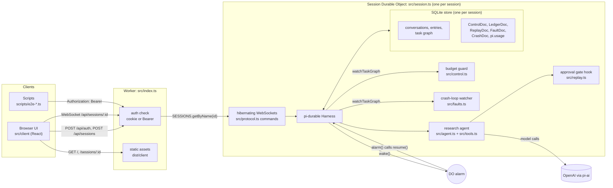
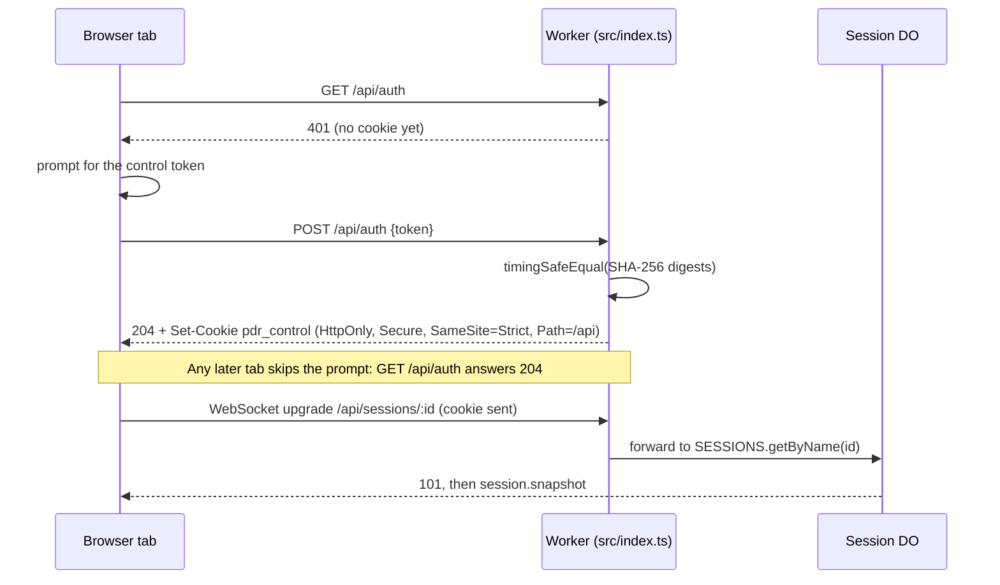
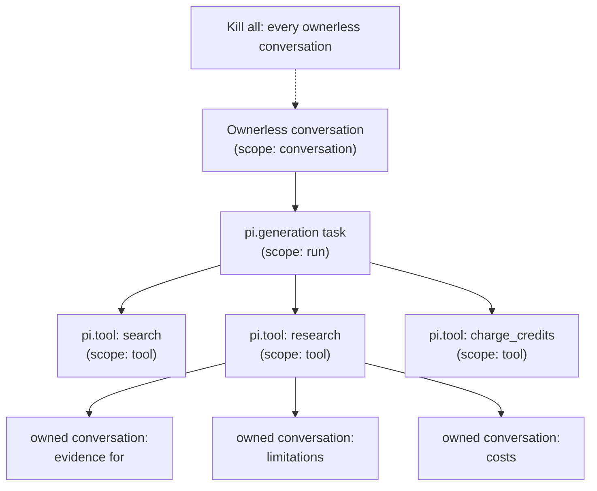
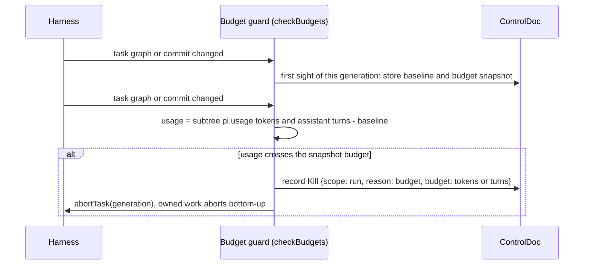
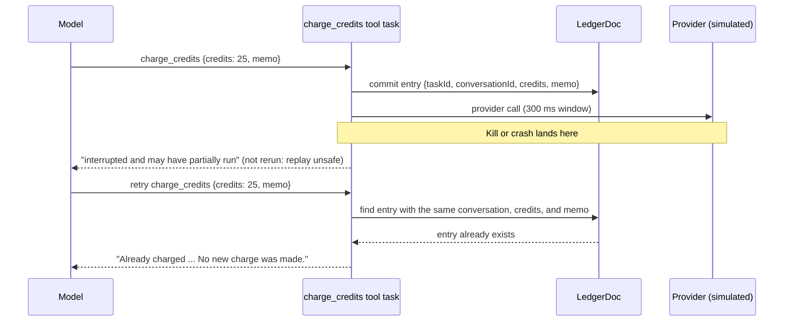
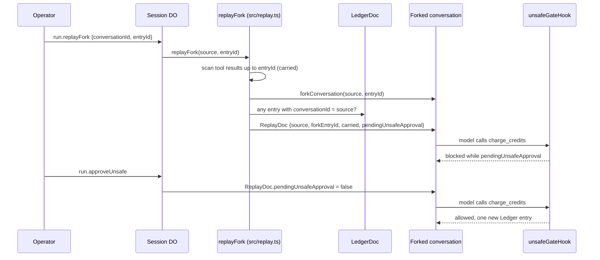
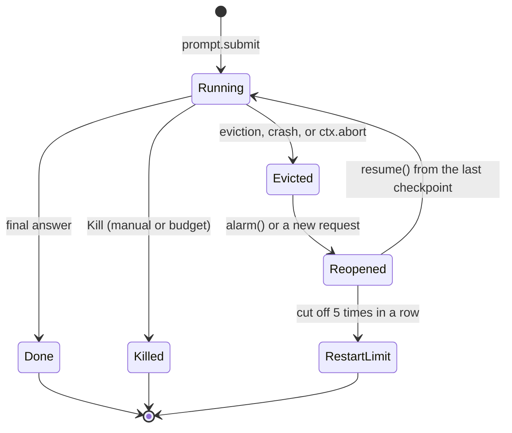

# SPEC - pi-durable-replay

Status: agreed in grill-with-docs, 23 Nov 2026 (Rounds 1-3, Q1-Q22).
Staged outside the repo. Per the commit sequence in the implementation plan, this file enters the repo at Unit 3, after the fork is bumped and migrated to Bun and verified green at each step.

## Problem

Two real complaints, from the 50-ideas list (23 Nov 2026):

- #4. Failed agent runs cannot be replayed without re-firing the tools that already ran, so a retry can repeat effects that already happened.
- #1. Runaway agent loops have no kill switch. The operator watches cost climb and can only kill the whole process.

## Product

A control plane wrapped around one sample Pi Durable agent. The operator watches every run as a task graph, kills runs at four scopes, and replays failures as forks that carry completed tool results forward and never re-fire an unsafe tool without fresh approval.

This is a devtool demo with a real core, not a mockup. Every claim in the UI is backed by committed state. The charge ledger is the proof of exactly-once, not a log line.

## Users

V1 has one user, the operator, gated by one bearer token. Any client holding the token can watch and steer any conversation in a session, because all UI state is committed state.

## The sample agent

A research agent.

- It fans out to three parallel subagents, each a durable task in its own conversation.
- Safe tools: `search` over the web through Exa when deployed (`SEARCH_BACKEND=exa`, key in the `EXA_API_KEY` Worker secret), and over a built-in corpus in tests and keyless local runs (`SEARCH_BACKEND=corpus`).
- Unsafe tool: `charge_credits`, fake credits only, writing a Ledger entry that records the tool task id and is idempotent on its intent (conversation, credits, memo), so a model retrying an interrupted charge gets the existing entry.
- Fault tools, first-class in the registry and labelled in the UI: `slow_search` (staged, streaming progress) and `loop_forever` (recruits subagent conversations until something stops it).

## Core concepts

Defined in GLOSSARY.md. The load-bearing distinctions:

- Resume continues the same run from its last checkpoint. Fork Replay creates a new conversation at a chosen entry. There is no third mode.
- A Kill applies to an Abort Scope: `run | tool | conversation | all`. Aborting a scope aborts everything it owns, bottom-up, and each owned task cleans up its own effect first.
- A Budget Kill is a Kill fired by the system at a budget crossing. It produces the same terminal state and the same report as a manual Kill.

## Architecture (Shape A)

Control plane inside the Session Durable Object. One DO per session owns the harness, all conversations, Control, and the Ledger. No second service, no cross-session store in v1.

Modules:

- `src/session.ts` (from the fork, kept): the DO host. Hibernating WebSockets, serialized alarm arming, view restore after eviction, `resume()` on wake.
- `src/protocol.ts` (extended): existing commands plus `task.abort`, `conversation.abort`, `run.replayFork`, `control.setBudgets`, `fault.inject`. Strict validation, as upstream.
- `src/control.ts` (new): `ControlDoc` via `defineDoc` (budgets, kill state), plus a hook that reads Control before each tool round and blocks or aborts at a budget crossing. An approval is recorded durably in the fork's `ReplayDoc`, so it is never asked twice across a crash. A fork whose source conversation charged (per the Ledger) arms the approval gate, whether or not the charge's result is in the carried history.
- `src/replay.ts` (new): Fork Replay in one function. Reads committed entries and tool task records, forks at the chosen entry, writes a `ReplayDoc` on the new conversation naming source conversation, fork entry, and carried tool results.
- `src/agent.ts` (renamed from `chat.ts`): model composition via pi-ai. OpenAI provider, default model as shipped by the fork, changeable per conversation.
- `src/tools.ts` (replaced): `search`, `charge_credits`, `slow_search`, `loop_forever`. Demo tools from the fork are deleted.
- Client (React): the chat surfaces render through assistant-ui over the session reducer (ADR 0005). `ActivityPanel` gains abort buttons and budget state. One new `ControlPanel` holds budgets, fault injection, replay, the Ledger, and usage.

Data shapes (five, plus the Ledger):

- `Session`: one DO, one SQLite store (pi-durable's Cloudflare storage).
- `Run`: derived from the task graph. Not stored separately.
- `Tool Intent`: the tool task's own committed checkpoint. Derived view, not a second store.
- `ControlDoc`: stored document. Budgets and kill state.
- `ReplayDoc`: stored document on the forked conversation. Provenance of a Fork Replay.
- `LedgerDoc`: stored document. One entry per charge, recording the tool task and conversation that made it; a repeat of the same intent in the same conversation returns the existing entry.

## How the system works

The diagrams below describe the code at this commit. Every box is a real module, binding, or stored document.

### Components

One Worker routes every request. Each session is one Durable Object that owns one pi-durable `Harness` and one SQLite store. The transcript, the task graph, and the app's documents live in that store, and every change to them is one atomic commit.

### Sign-in

The browser signs in once. The Worker answers with a cookie that holds a SHA-256 digest of `CONTROL_TOKEN`, never the token. Every tab and every WebSocket upgrade send the cookie, so a new tab does not ask again.

### A run, its owned work, and the Abort Scopes

A run is one live `pi.generation` task in an ownerless conversation. Tool calls are tool tasks owned by the generation. `research` creates three conversations owned by its tool task. A Kill aborts a scope and everything it owns, bottom-up.

The budget guard runs whenever the task graph or the commit stream moves. When it first sees a run, it records a baseline: the subtree's tokens and turns, plus the budgets in force at that moment. It judges the run against that snapshot, so a budget edit applies to the next run only.

### A charge lands exactly once

`charge_credits` commits its Ledger entry before the provider call. The entry is idempotent on its intent: conversation, credits, and memo. An interrupted unsafe tool is never rerun by the harness. If the model retries the charge itself, the retry finds the landed entry and charges nothing.

### Fork Replay and the approval gate

Fork Replay forks the source conversation at a chosen entry and writes a `ReplayDoc` on the new conversation. Committed tool results before the fork point are history in the fork, so their tools do not run again. The gate arms from the Ledger, not from the carried results. A charge whose result sits after the fork point, or never committed, still blocks.

### Recovery after eviction or a crash

Memory is lost on eviction. Storage is not. The host arms the DO alarm from `harness.wake()` before any work can start. A new request or the alarm reopens the Harness, and `resume()` continues each task from its last committed checkpoint. A safe tool reruns. An unsafe tool reports that it was interrupted. A task cut off `restartLimit` (5) times in a row ends with `restart_limit`.

## Budgets

Default per run: 100,000 tokens or 30 turns, whichever comes first. Stored in `ControlDoc`, editable in the Control Panel, applied to the next run only. Usage comes from pi-durable's built-in `pi.usage` document.

## Fault demo

Local Bun mode: a real `kill -9` mid-tool-call, then reopen and Resume.
Cloudflare mode: three injected faults from one panel.

1. An interrupted unsafe tool. On resume it is reported interrupted, never re-fired, and the Ledger still shows one entry.
2. A crash-loop tool hitting the restart limit (default 5), ending with a `restart_limit` report.
3. A Durable Object eviction, woken through the alarm, resuming mid-run. Eviction in tests uses `evictDurableObject` from `cloudflare:test`, as in the fork's recovery tests.

## Toolchain

Bun only. Bun is the package manager (`bun.lock`, no pnpm lockfile), the script runner, and the local runtime. `packageManager` and all documented commands say Bun. Wrangler deploys, invoked through Bun. One exception: Vitest stays as the test runner, invoked by `bun run`, because the Cloudflare workers pool and its eviction and alarm helpers have no Bun test equivalent. The migration gate is `bun install`, `bun run check`, and the full test suite green. If the workers pool breaks under Bun, work stops and the failure is reported. No silent Node fallback.

Runtime truth: the deployed runtime is workerd. Bun never runs in production on Cloudflare.

## Auth

One control token, the `CONTROL_TOKEN` Worker secret, gating the API at the seam marked in the fork's `src/index.ts`. Scripts send it as `Authorization: Bearer`. The browser posts it once to `POST /api/auth` and receives an HttpOnly cookie holding its digest, shared by every tab and every WebSocket upgrade (see the sign-in diagram). The model API key is a Worker secret and a local `.dev.vars` entry. No secret is ever committed. No accounts, no multi-tenancy, no rate limiting beyond the token gate in v1.

## Deploy

Cloudflare Workers, name `pi-durable-replay`, first deploy to its `workers.dev` address. GitHub Actions deploys on every push to `main`. Worker secrets: `OPENAI_API_KEY`, `CONTROL_TOKEN`, and `EXA_API_KEY`. Deploy is gated on the operator's explicit go-ahead at deploy time, with the exact wrangler target shown first. Custom domain is out of v1.

## Acceptance tests (behavior, not implementation)

1. Kill a run during `slow_search`. The run ends in the kill terminal state, owned tasks end bottom-up, and a report reaches the client.
2. Start `loop_forever` with default budgets. A Budget Kill ends it. The UI shows which budget fired.
3. Run a research task that charges credits, interrupt it during or after the charge, then Resume. The Ledger holds exactly one entry for that tool task.
4. Fail a run after two safe tools complete. Fork Replay from the entry before the failure. The two completed tool results are carried forward, neither safe tool runs again, and the unsafe tool does not run without fresh approval.
5. Evict the DO mid-generation in a test. The run resumes after the alarm and answers.
6. Crash-loop a tool five times. It ends with `restart_limit` and does not run a sixth time.
7. Restart the local Bun harness with `kill -9` mid-tool-call. Safe tools rerun, unsafe tools are reported interrupted.
8. Change budgets in the Control Panel. The run in flight keeps its budgets. The next run uses the new ones.

## Out of scope for v1 (the cut line)

- A generic inspector for other Pi Durable apps, or any other framework.
- A cross-session dashboard or any second service (Shape B).
- Accounts, multi-tenancy, billing, real payments.
- A coding agent workload (Cloudflare gives tools no real shell or filesystem in this design).
- Custom domain.
- Replacing Vitest with `bun test`.
