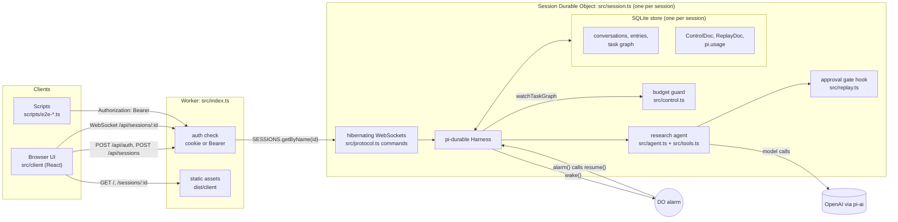
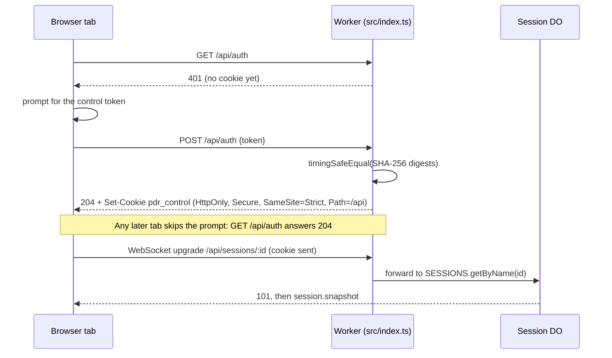
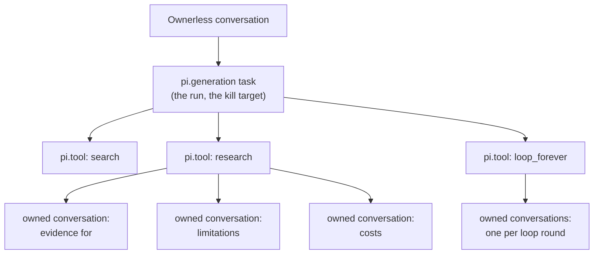
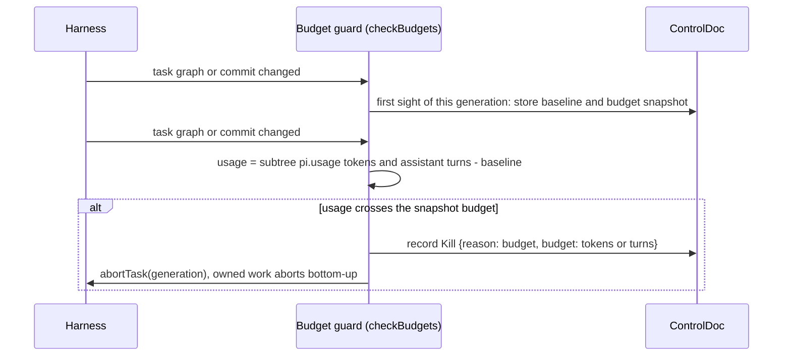
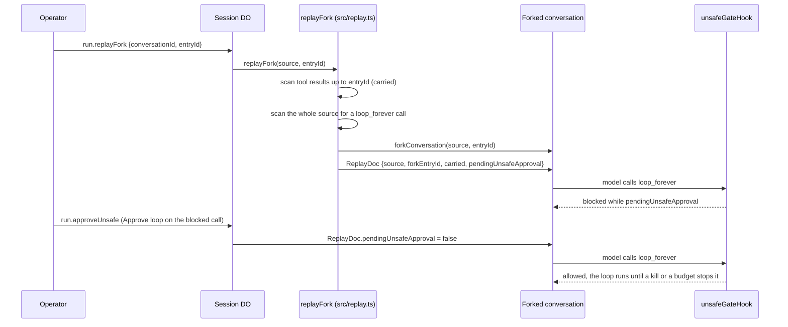
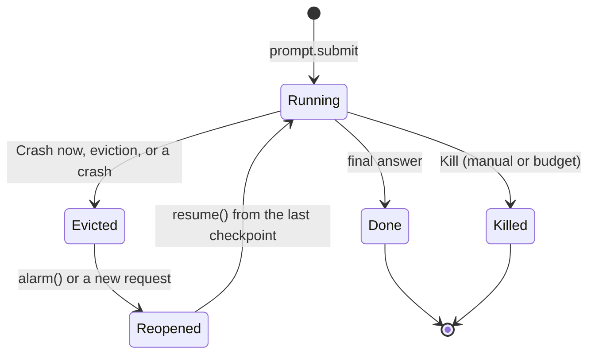

# SPEC - pi-durable-replay

Status: agreed in grill-with-docs, 23 Nov 2026 (Rounds 1-3, Q1-Q22).
Simplified 24 Nov 2026 to three features and one fault, per [docs/plans/0002-simplify-demo.md](docs/plans/0002-simplify-demo.md).
Staged outside the repo. Per the commit sequence in the implementation plan, this file enters the repo at Unit 3, after the fork is bumped and migrated to Bun and verified green at each step.

## Problem

Two real complaints, from the 50-ideas list (23 Nov 2026):

- #4. Failed agent runs cannot be replayed without re-firing the tools that already ran, so a retry can repeat effects that already happened.
- #1. Runaway agent loops have no kill switch. The operator watches cost climb and can only kill the whole process.

## Product

A control plane wrapped around one sample Pi Durable agent. It demonstrates three pi-durable features:

1. Cost control. Each run has a token budget and a turn budget, and the Budget Kill stops a run that crosses either one.
2. Kill switch. The composer's **Kill run** button kills the live run and everything it owns. The Control panel's kill log records every kill and its reason.
3. Replay without re-firing effects. Fork Replay carries completed tool results forward, so `search` and `research` do not run again. `loop_forever` stays blocked in the fork until the operator approves it on the blocked call.

One fault, **Crash now**, evicts the Durable Object. The run resumes through the alarm from its last checkpoint.

This is a devtool demo with a real core, not a mockup. Every claim in the UI is backed by committed state. The kill log and the replay provenance are stored documents, not log lines.

## Users

V1 has one user, the operator, gated by one bearer token. Any client holding the token can watch and steer any conversation in a session, because all UI state is committed state.

## The sample agent

A research agent.

- Safe tool `search`, over the web through Exa when deployed (`SEARCH_BACKEND=exa`, key in the `EXA_API_KEY` Worker secret), and over a built-in corpus in tests and keyless local runs (`SEARCH_BACKEND=corpus`).
- Safe tool `research`, which fans out to three parallel subagents. Each subagent is a durable task in its own conversation and has the `search` tool.
- Unsafe tool `loop_forever`, the one fault tool, labelled in the UI. It recruits subagent conversations that call it again, until a kill or a budget stops it.

## Core concepts

Defined in GLOSSARY.md. The load-bearing distinctions:

- Resume continues the same run from its last checkpoint. Fork Replay creates a new conversation at a chosen entry. There is no third mode.
- A Kill applies to a run. Killing a run aborts everything it owns, bottom-up, and each owned task cleans up its own effect first.
- A Budget Kill is a Kill fired by the system at a budget crossing. It produces the same terminal state and the same kill record as a manual Kill.

## Architecture (Shape A)

Control plane inside the Session Durable Object. One DO per session owns the harness, all conversations, Control, and the replay documents. No second service, no cross-session store in v1.

Modules:

- `src/session.ts` (from the fork, kept): the DO host. Hibernating WebSockets, serialized alarm arming, view restore after eviction, `resume()` on wake, and the Crash now eviction.
- `src/protocol.ts` (extended): the commands `conversation.open`, `conversation.entries`, `conversation.create`, `prompt.submit`, `task.abort` (kill a run by its generation task), `run.replayFork`, `run.approveUnsafe`, `fault.inject` (Crash now), and `control.setBudgets`. Strict validation, as upstream.
- `src/control.ts` (new): `ControlDoc` via `defineDoc` (budgets, the kill log, run baselines), `kill()` for one run, and the budget guard `checkBudgets`, which the host calls whenever the task graph or the commit stream moves.
- `src/replay.ts` (new): Fork Replay in one function. Reads committed entries, forks at the chosen entry, and writes a `ReplayDoc` on the new conversation naming source conversation, fork entry, and carried tool results. A source conversation with a committed `loop_forever` call arms the approval gate, wherever the call sits relative to the fork point. `unsafeGateHook` blocks `loop_forever` while the gate is armed. An approval is recorded durably in the fork's `ReplayDoc`, so it is never asked twice across a crash.
- `src/agent.ts` (renamed from `chat.ts`): model composition via pi-ai. OpenAI provider, default model as shipped by the fork, changeable per conversation.
- `src/tools.ts` (replaced): `search`, `research`, `loop_forever`. Demo tools from the fork are deleted.
- Client (React): the chat surfaces render through assistant-ui over the session reducer (ADR 0005), styled with Tailwind v4 and copied shadcn components (ADR 0006). The composer's stop button is **Kill run**. The blocked `loop_forever` call in a Fork Replay carries the **Approve loop** card. `ActivityPanel` shows the task graph and is read-only. `ControlPanel` holds budgets, usage, Crash now, the kill log, and replay provenance.

Data shapes (five):

- `Session`: one DO, one SQLite store (pi-durable's Cloudflare storage).
- `Run`: derived from the task graph. Not stored separately.
- `Tool Intent`: the tool task's own committed checkpoint. Derived view, not a second store.
- `ControlDoc`: stored document. Budgets, the kill log, and the baseline of each live run.
- `ReplayDoc`: stored document on the forked conversation. Provenance of a Fork Replay and its approval state.

## How the system works

The diagrams below describe the code at this commit. Every box is a real module, binding, or stored document.

### Components

One Worker routes every request. Each session is one Durable Object that owns one pi-durable `Harness` and one SQLite store. The transcript, the task graph, and the app's documents live in that store, and every change to them is one atomic commit.

### Sign-in

The browser signs in once. The Worker answers with a cookie that holds a SHA-256 digest of `CONTROL_TOKEN`, never the token. Every tab and every WebSocket upgrade send the cookie, so a new tab does not ask again.

### A run, its owned work, and the run kill

A run is one live `pi.generation` task in an ownerless conversation. Tool calls are tool tasks owned by the generation. `research` creates three conversations owned by its tool task, and `loop_forever` creates one per round. A Kill aborts the run and everything it owns, bottom-up. **Kill run** sends `task.abort` with the generation's task id, and the budget guard calls the same `kill()`.

The budget guard runs whenever the task graph or the commit stream moves. When it first sees a run, it records a baseline: the subtree's tokens and turns, plus the budgets in force at that moment. It judges the run against that snapshot, so a budget edit applies to the next run only.

### Fork Replay and the approval gate

Fork Replay forks the source conversation at a chosen entry and writes a `ReplayDoc` on the new conversation. Committed tool results before the fork point are history in the fork, so their tools do not run again. The gate arms from the source conversation's committed `loop_forever` calls, not from the carried results. A tool call commits before its tool runs, so the call proves the loop started. A loop whose call sits after the fork point still blocks.

### Recovery after Crash now

Memory is lost on eviction. Storage is not. The host arms the DO alarm from `harness.wake()` before any work can start. **Crash now** sends `fault.inject`. The host replies, arms an alarm 250 ms ahead, and calls `ctx.abort()`. The alarm reopens the Harness, and `resume()` continues each task from its last committed checkpoint. A safe tool reruns. An unsafe tool reports that it was interrupted.

## Budgets

Default per run: 100,000 tokens or 30 turns, whichever comes first. Stored in `ControlDoc`, editable in the Control Panel, applied to the next run only. Usage comes from pi-durable's built-in `pi.usage` document.

## Fault demo

One injected fault, **Crash now**, in the Control panel. It evicts the Durable Object mid-run. The object wakes through its alarm and resumes the run from its last checkpoint. Eviction in tests uses `evictDurableObject` from `cloudflare:test`, as in the fork's recovery tests.

## Toolchain

Bun only. Bun is the package manager (`bun.lock`, no pnpm lockfile), the script runner, and the local runtime. `packageManager` and all documented commands say Bun. Wrangler deploys, invoked through Bun. One exception: Vitest stays as the test runner, invoked by `bun run`, because the Cloudflare workers pool and its eviction and alarm helpers have no Bun test equivalent. The migration gate is `bun install`, `bun run check`, and the full test suite green. If the workers pool breaks under Bun, work stops and the failure is reported. No silent Node fallback.

Runtime truth: the deployed runtime is workerd. Bun never runs in production on Cloudflare.

## Auth

One control token, the `CONTROL_TOKEN` Worker secret, gating the API at the seam marked in the fork's `src/index.ts`. Scripts send it as `Authorization: Bearer`. The browser posts it once to `POST /api/auth` and receives an HttpOnly cookie holding its digest, shared by every tab and every WebSocket upgrade (see the sign-in diagram). The model API key is a Worker secret and a local `.dev.vars` entry. No secret is ever committed. No accounts, no multi-tenancy, no rate limiting beyond the token gate in v1.

## Deploy

Cloudflare Workers, name `pi-durable-replay`, first deploy to its `workers.dev` address. GitHub Actions deploys on every push to `main`. Worker secrets: `OPENAI_API_KEY`, `CONTROL_TOKEN`, and `EXA_API_KEY`. Deploy is gated on the operator's explicit go-ahead at deploy time, with the exact wrangler target shown first. Custom domain is out of v1.

## Acceptance tests (behavior, not implementation)

Renumbered on 24 Nov 2026. Each test names the file that covers it and, in quotes, the number its test name still uses from the original list.

1. Kill a run during `loop_forever`. The run ends in the kill terminal state, owned tasks end bottom-up, and the kill log records it. (`test/control.test.ts`, "test 1")
2. Start `loop_forever` with default budgets. A Budget Kill ends it. The kill record names the budget that fired. (`test/control.test.ts`, "test 2")
3. Fail a run after two safe tools complete. Fork Replay from the newest entry. The two completed tool results are carried forward, and neither safe tool runs again. (`test/replay.test.ts`, "test 4")
4. Run `search`, then `loop_forever`, and kill the run. Fork Replay from the entry after `search`, before the `loop_forever` call. `search` is carried and does not run again. `loop_forever` is blocked until the operator approves it, and then it runs. (`test/replay.test.ts`, the `loop_forever` gate test)
5. Evict the DO mid-generation in a test. The run resumes after the alarm and answers. (`test/faults.test.ts`, "test 5")
6. Change budgets in the Control Panel. The run in flight keeps its budgets. The next run uses the new ones. (`test/control.test.ts`, "test 8")

## Out of scope for v1 (the cut line)

- A generic inspector for other Pi Durable apps, or any other framework.
- A cross-session dashboard or any second service (Shape B).
- Accounts, multi-tenancy, billing, real payments.
- A coding agent workload (Cloudflare gives tools no real shell or filesystem in this design).
- Custom domain.
- Replacing Vitest with `bun test`.
